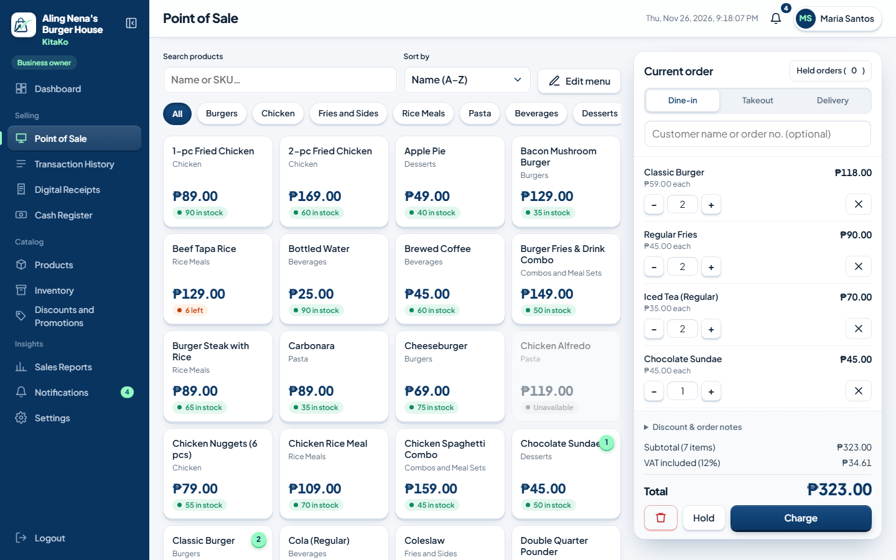
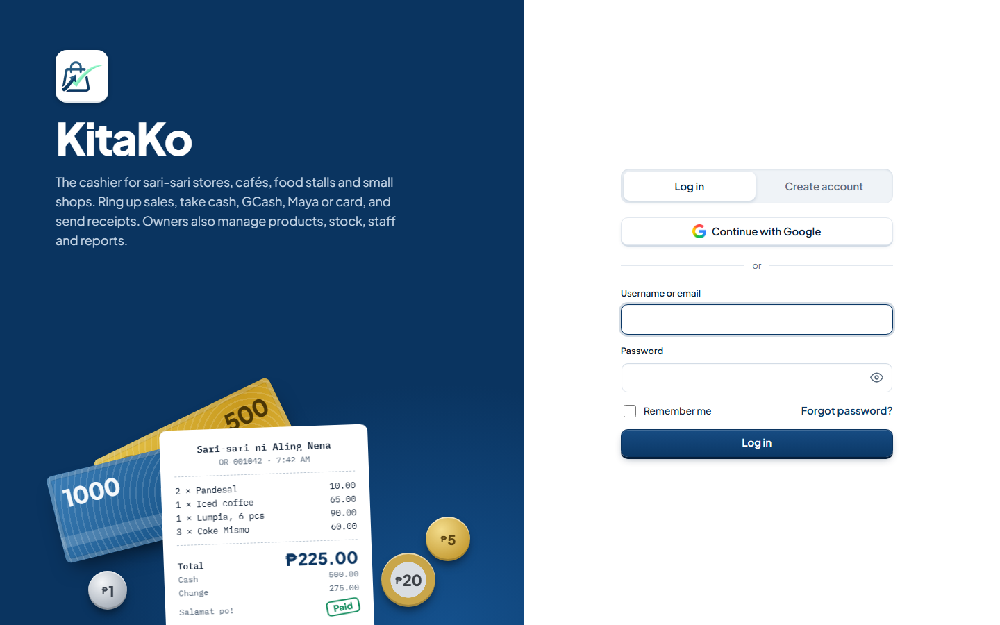
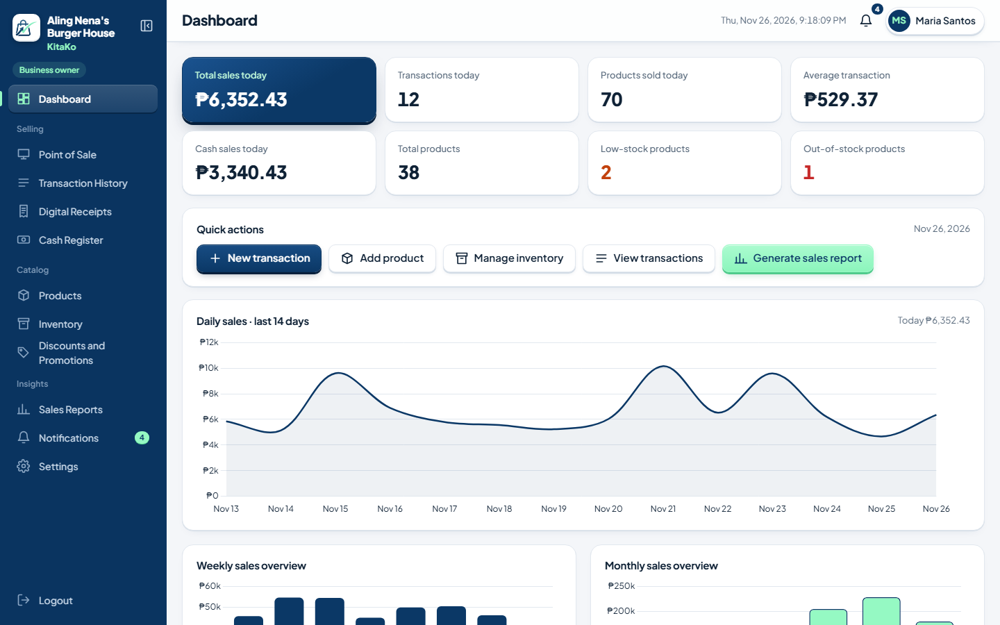
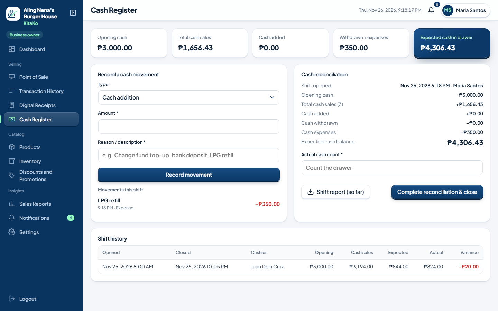
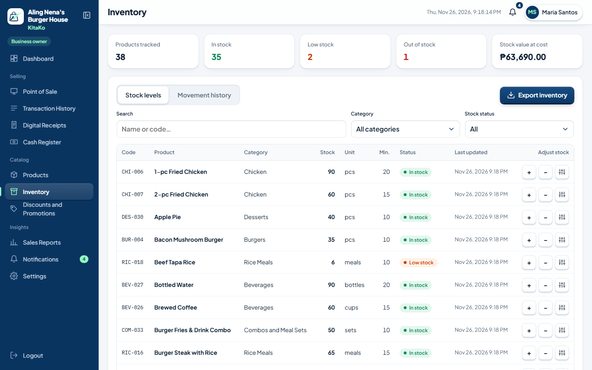
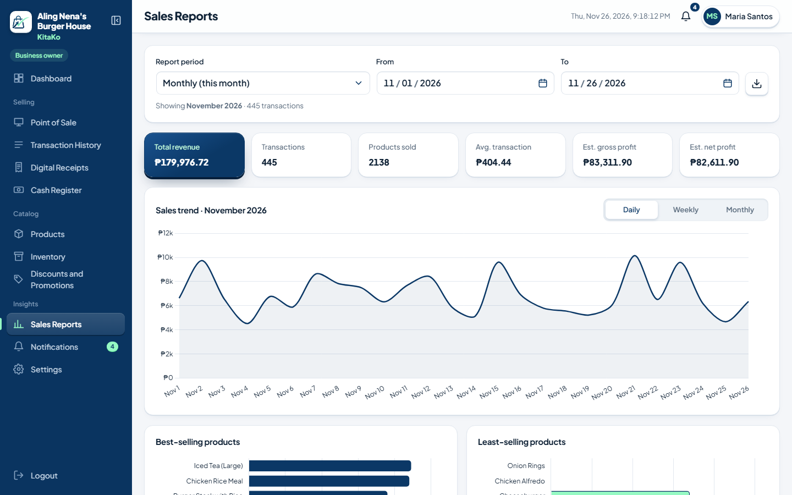

<p align="center">
  
</p>

<h1 align="center">KitaKo</h1>

<p align="center">
  A cashier (point-of-sale) system for sari-sari stores, cafés, food stalls, bakeries and small shops.<br>
  <b>Live app: <a href="https://kitako-lake.vercel.app">kitako-lake.vercel.app</a></b>
</p>

<p align="center">
  
  
  
  
</p>

<p align="center">
  
  
  
  
  
  
  
</p>

<p align="center">
  <a href="https://kitako-lake.vercel.app"></a>
  
  
  
  
  
</p>

| | |
|---|---|
| **Version** | 1.0.0 |
| **Platform** | Web app for Chrome, Edge, Firefox and Safari on desktop, tablet and phone |
| **Frontend** | HTML, CSS and vanilla JavaScript (MVC), no framework |
| **Backend** | Supabase: PostgreSQL with Row Level Security, Auth (email code + Google) |
| **Hosting** | Vercel (static site) |
| **Made for** | Small businesses in the Philippines: ₱, 12% VAT, Senior Citizen and PWD discounts, GCash and Maya |

<p align="center">
  
</p>

---

## Contents

- [What KitaKo is](#what-kitako-is)
- [Screenshots](#screenshots)
- [Features](#features)
- [Owners and cashiers](#owners-and-cashiers)
- [A day at the counter](#a-day-at-the-counter)
- [How prices are worked out](#how-prices-are-worked-out)
- [Reports and what the numbers mean](#reports-and-what-the-numbers-mean)
- [Getting started](#getting-started)
- [FAQ](#faq)
- [For developers](#for-developers)
- [Known limits](#known-limits)

## What KitaKo is

KitaKo is a point-of-sale app for small Filipino businesses. It runs in the browser on a laptop, tablet or phone, so there is nothing to install and no special hardware to buy.

- **The owner** sets up the business, the menu or product list, prices, VAT, discounts and staff, and follows sales, stock and profit.
- **Cashiers** open a shift, ring up orders, take payment, give receipts and balance the cash drawer at the end of the shift.

All data is saved online in [Supabase](https://supabase.com). Several phones or computers can sell for the same business at the same time, and the owner can check the numbers from anywhere.

## Screenshots

| | |
|---|---|
| <br>**Log in / create account** | <br>**Dashboard** — today's sales at a glance |
| <br>**Point of sale** — tap products, charge | <br>**Cash register** — shift and drawer count |
| <br>**Inventory** — stock levels and alerts | <br>**Sales reports** — trends and profit |

*Screenshots use the optional starter menu (a burger and chicken restaurant) with example sales.*

## Features

### Selling
- **Product board** with category chips, search by name or SKU, and sorting. Each tile shows the price and stock left; sold-out and unavailable items can't be added.
- **Order types:** dine-in, takeout and delivery. Dine-in can add a service charge and delivery a delivery fee (both set in Settings).
- **Hold orders** and resume them later, for example when a customer steps away.
- **Discounts at checkout:** Senior Citizen, PWD (with ID number) and the business's own discounts and promos.
- **Customer name / order number** and order notes ("no onions").
- **Payment methods:** Cash (with quick amounts and the change worked out), GCash, Maya, Debit Card and Credit Card (the reference or approval number is recorded).
- **Shift required:** the point of sale stays locked until a shift is opened with the cash in the drawer.

### Receipts and transactions
- Every sale gets an official-receipt-style number (`OR-001042`) and a **digital receipt** with items, discounts, VAT breakdown, payment and change.
- **Print** a receipt, **download it as PDF**, or reprint any past one.
- **Transaction history** with search (ID, receipt number, customer) and filters by date, payment method and order type. Export to **CSV, Excel or PDF**.

### Cash register
- **Open a shift** by counting the opening cash.
- Record **cash added** (change fund top-up), **withdrawn** (bank deposit) and **expenses** (LPG refill) during the shift.
- **Close the shift**: KitaKo shows the cash that *should* be in the drawer, you enter what is actually there, and it records the **shortage or overage**. Download a **shift report (PDF)**.
- **Shift history** for every past shift. Whoever opened a shift has to close it before logging out.

### Products, stock and discounts
- **Products** with SKU, category, price, cost, unit, minimum stock and availability. Categories can be added, renamed and removed.
- **Inventory**: add, deduct or set stock with a reason; every change goes into a **movement history**. Low-stock and out-of-stock items are flagged. Export the stock list.
- **Discounts and promotions**: percentage, fixed amount, promo (with a minimum spend), Senior Citizen and PWD, each with optional start and end dates.

### Reports
- **Dashboard:** today's sales, transactions, items sold, average sale, cash sales, stock alerts, 14-day trend, weekly and monthly totals, best sellers, popular categories and recent transactions.
- **Sales reports** for today, the last 7 days, this month, this year or any date range — see [what the numbers mean](#reports-and-what-the-numbers-mean). Export to **CSV, Excel or PDF**.

### Notifications
Low stock, out of stock, completed sales, inventory changes, product changes, cash register events, a daily summary of yesterday's sales, and account events. Each kind can be turned on or off in **Settings → Notifications**.

### Accounts and security
- Sign up with **email** (verified with a code sent by email) or **Google**.
- **Forgot password** with an emailed code; change email or password from Settings.
- Each business's data is visible only to its own owner and cashiers (enforced by the database, not just the app).
- The **business password** (for cashiers' business mode) is stored as a one-way hash.

## Owners and cashiers

| | Owner | Cashier | Cashier in business mode |
|---|:---:|:---:|:---:|
| Point of sale, receipts during sales | ✓ | ✓ | ✓ |
| Cash register (open, record, close shifts) | ✓ | ✓ | ✓ |
| Own profile, password, log out | ✓ | ✓ | ✓ |
| Dashboard, transactions, digital receipts, reports | ✓ | | ✓ |
| Products, inventory, discounts, notifications | ✓ | | ✓ |
| Business settings (VAT, receipt footer, staff) | ✓ | | ✓ |
| Change the business password, rename or remove cashiers | ✓ | | |

**Business mode** is for a trusted cashier who needs to do more than sell (for example restock or check a report). They unlock it with the **business password** the owner sets, and lock it again from the sidebar.

**Adding staff:** cashiers create their own account (**Create account → Cashier**) and join with the **business username** from **Settings → Business account & staff**. The owner can rename or remove them there.

## A day at the counter

1. **Open the shift.** Go to **Point of Sale** (or **Cash Register**), count the cash in the drawer and enter it.
2. **Sell.** Tap products, choose dine-in / takeout / delivery, add a discount if needed, then **Charge**. Pick the payment method, enter the cash received or the reference number, and confirm. The receipt appears; print it or download it.
3. **Cash in and out.** If cash goes in or out of the drawer for something other than a sale, record it on **Cash Register** with a reason.
4. **Close the shift.** On **Cash Register**, count the drawer, enter the actual amount and choose **Complete reconciliation & close**. Download the shift report if you want a copy.
5. **Log out.**

## How prices are worked out

Set in **Settings → Financial & receipts**:

- **VAT** (12% by default). If **menu prices already include VAT** is on, the price on the menu is what the customer pays and the receipt shows the VAT inside it. If it's off, VAT is added on top.
- **Service charge** (dine-in only) — a percentage of the subtotal.
- **Delivery fee** (delivery only) — a fixed amount per order.
- **Senior Citizen and PWD** — when **VAT-exempt** is on (the default, following Philippine law), the VAT is removed first and the discount (20% by default) is taken off the VAT-exclusive price. The receipt shows the VAT-exempt amount and the ID number.
- **Other discounts** — percentage or fixed amount off the subtotal; promos only apply once the minimum spend is reached.

Example with VAT-inclusive prices: a ₱112 order is ₱100 + ₱12 VAT. With a Senior Citizen discount it becomes ₱100 − 20% = **₱80**.

## Reports and what the numbers mean

| Figure | Meaning |
|---|---|
| Total revenue | Everything customers paid in the period (after discounts, including VAT and charges) |
| Transactions / Products sold | Number of sales / number of items sold |
| Average transaction | Revenue ÷ transactions |
| Discounts given, VAT collected | Totals across the period |
| Net sales (ex-VAT) | Revenue without VAT |
| Estimated gross profit | Sales after discounts, without VAT and service/delivery charges, minus the **cost** of the items sold. Products without a cost are left out, so enter costs for an accurate figure |
| Estimated net profit | Gross profit minus the **expenses** recorded in Cash Register during the period |
| Gross margin | Gross profit as a percentage of those sales |

Charts show the sales trend (daily, weekly or monthly), best- and least-selling products, sales by category, payment method and order type, peak sales hours and transaction volume.

## Getting started

Open **https://kitako-lake.vercel.app**.

1. Choose **Create account** and sign up as a **Business owner**.
2. Enter the code sent to your email, then set up your business: name, address, contact details, VAT TIN, a **business username** (cashiers use it to join) and a **business password** (for business mode). Tick **Add a starter menu** to get example products and 90 days of example sales to explore.
3. Add your own products in **Products** (or edit the starter menu), and check **Settings → Financial & receipts** for VAT, charges and the receipt footer.
4. Open a shift and make your first sale.
5. Ask your cashiers to sign up as **Cashier** and join with the business username.

There are no built-in accounts.

## FAQ

**Do I need internet?** Yes. Sales are saved online as you work. If the connection drops, KitaKo warns you and keeps retrying while the page stays open.

**Can I use it on my phone?** Yes. The layout adapts to phones and tablets; on a phone the current order opens from a **View order** bar at the bottom.

**Can two cashiers sell at the same time?** Yes, on separate devices. Both sales are kept and stock goes down for both. Each device has its own cart.

**Does KitaKo take GCash or card payments?** It records them. The customer pays with their own app or the card terminal, and the cashier types the reference number into KitaKo. There is no payment gateway.

**Are the receipts official BIR receipts?** No. KitaKo is not BIR-accredited; its receipts are sales receipts for the customer and the business's records.

**What does "Add a starter menu" do?** It fills a new business with a sample burger-and-chicken menu, promos and 90 days of example sales so you can explore the reports. Edit or delete them anytime.

**I forgot the business password.** The owner can set a new one in **Settings → Business account & staff**.

## For developers

### Tech stack

- HTML, CSS and plain JavaScript in an MVC structure — no framework and no build step.
- [Supabase](https://supabase.com) — Postgres database, Auth (email + Google) and Row Level Security.
- From a CDN: Supabase JS, Chart.js (charts), jsPDF + AutoTable (PDF), SheetJS (Excel), Google Fonts (Plus Jakarta Sans, IBM Plex Mono).
- Hosted on [Vercel](https://vercel.com) as a static site.

### Run it locally

You need Python 3 and an internet connection.

```
python tools/serve.py
```

Then open **http://localhost:5500**. In VS Code you can press **F5** instead. This server turns off browser caching, so your edits show up on a normal reload.

Opening `index.html` straight from disk does not work: sign-in needs an `http://` or `https://` address.

To get a single shareable file, run `python tools/build.py`. It writes `dist/KitaKo.html` with the CSS, scripts and images inlined. It still connects to Supabase, so host it at an address listed in Supabase (step 3 below).

### Set up your own Supabase project

The app in this repository is already connected to a Supabase project through [`js/config.js`](js/config.js). To use your own:

1. **Create the database.** In your Supabase project open **SQL Editor → New query**, paste all of [`supabase/schema.sql`](supabase/schema.sql) and click **Run**. It creates the tables, security rules and functions, and is safe to run again.
2. **Connect the app.** Open **Project Settings → API** (or the **Connect** button) and copy the **Project URL** and the **Publishable key** (`sb_publishable_…`, or the legacy `anon` key) into [`js/config.js`](js/config.js). Never put the secret / `service_role` key in the app.
3. **Set the site addresses.** In **Authentication → URL Configuration** set **Site URL** to your live address (for example `https://kitako-lake.vercel.app`) and add each address you open KitaKo from under **Redirect URLs**, for example `https://kitako-lake.vercel.app/**` and `http://localhost:5500/**`.
4. **Make emails send codes.** KitaKo asks for a code from the email, not a link. In **Authentication → Emails → Templates**, put `{{ .Token }}` in **Confirm signup**, **Reset password** and **Change email address**, for example `<p>Your KitaKo code is <b>{{ .Token }}</b></p>`.
5. **Email changes.** Under **Authentication → Sign In / Providers → Email**, turn off **Secure email change** so a new email needs only the code sent to the new address.
6. **Email sending.** Supabase's built-in sender only sends a few emails per hour and is meant for testing. For real use, add your own SMTP server (for example Resend or Brevo) under **Authentication → Emails → SMTP Settings**.
7. **Google sign-in (optional).** In Google Cloud Console create an OAuth client (**Web application**) with `https://<your-project>.supabase.co/auth/v1/callback` as an **Authorized redirect URI**. Then in Supabase **Authentication → Sign In / Providers → Google**, turn it on and paste the client ID and secret.

### Deploy on Vercel

1. On [vercel.com](https://vercel.com), choose **Add New… → Project** and import this GitHub repository.
2. Set **Framework Preset** to **Other** and leave the build command and output directory empty. No environment variables are needed.
3. Click **Deploy**, then add the Vercel address to Supabase (step 3 above).

Every push to `main` deploys again automatically.

### Project structure (MVC)

```
kitako/
├── index.html                 Page markup (login, sign-up steps, app shell) and script loading order
├── assets/
│   ├── css/style.css          All styles (navy #0B3866 + mint #95F9C3)
│   └── img/                   logo.png, logo-white.png, favicon.png, google.png
├── docs/screenshots/          Images used in this README
├── js/
│   ├── config.js              Supabase project URL and publishable key
│   ├── utils.js               Shared helpers: $ / $$, escaping, money, dates
│   ├── models/                MODEL — data and business rules, no screen code
│   │   ├── Store.js           Supabase client, loading and saving business data (with merge), session, ModelEvents
│   │   ├── SampleData.js      Default settings, optional starter menu with 90 days of example sales
│   │   ├── AccountModel.js    Users, roles, access rules, readable error messages
│   │   ├── ProductModel.js    Products, categories, stock status, stock movement log
│   │   ├── SalesModel.js      Pricing (VAT, Senior/PWD), discounts, transactions, cart
│   │   ├── NotificationModel.js  Notifications (honours the on/off switches in Settings)
│   │   ├── ReportModel.js     Sales analytics: trends, best sellers, profit estimates
│   │   └── RegisterModel.js   Cash drawer arithmetic for shifts
│   ├── views/                 VIEW — what the user sees
│   │   ├── components.js      Icons, toasts, dialogs, charts, receipt layout, date picker, dropdown list
│   │   ├── exports.js         CSV, Excel and PDF output (receipts, reports, shift reports)
│   │   └── pages/*View.js     HTML templates for each screen and dialog
│   ├── controllers/           CONTROLLER — handles user actions
│   │   ├── AppController.js   Routing, sidebar, roles/business mode, logout
│   │   ├── AuthController.js  Supabase Auth: log in, Google, 3-step sign-up with emailed code, password reset
│   │   └── …Controller.js     One per screen: Dashboard, Pos, Product, Inventory, Transaction,
│   │                          Receipt, Report, Discount, Register, Notification, Settings
│   └── app.js                 Boot: restore the session, show login or app
├── supabase/schema.sql        Database tables, security rules and functions (run once in Supabase)
├── tools/serve.py             Local server for development (no caching)
└── tools/build.py             Bundles everything into dist/KitaKo.html
```

### How the layers talk

- **Controllers** respond to clicks and form submits. They validate input, call **model** functions to change data, then render a **view** template into the page and attach event handlers.
- **Models** hold the state (`S`) and the rules: VAT and discount maths, stock deduction, access control, syncing with Supabase. They never touch the screen. When a model needs the screen to react, it emits an event through `ModelEvents` (for example `notifications:changed`, `data:remote`, `sync:error`) and a view subscribes to it (observer pattern).
- **Views** return HTML strings. A controller passes in the values a template needs (for example `PosView.totals({c, d, lines, st, t})`); templates may also read model data for display.

Example — completing a cash sale:

1. `PosController.openPayment()` shows `PosView.checkoutModal(...)` and `PosView.cashPane(...)`.
2. On **Confirm payment**, `PosController.completeSale()` calls the models: `buildTxn()` (SalesModel) to create the transaction, `changeStock()` (ProductModel) for every item, and `notify()` (NotificationModel).
3. It saves through `save()` (Store), which uploads the changed data to Supabase in the background, then shows the receipt using `ReceiptView` and `receiptHTML()` (views/components).

The files are plain browser scripts (not ES modules). They share one global scope and load in this order: `config → utils → models → views → controllers → app.js`. The full list is at the bottom of `index.html`.

### Data storage

| Where | Contents |
|---|---|
| Supabase Auth (`auth.users`) | Logins: email + password (hashed by Supabase), Google accounts, sessions |
| `profiles` | Name, username, email, role (owner / cashier) and business of each login |
| `businesses` | Business name, business username and owner |
| `business_secrets` | Business password (bcrypt hash). No one can read this table; the app only asks "is this password right?" |
| `business_data` | One business's data, one row per type: settings, categories, products, held orders, discounts, cash register, notifications, receipt counter. Sales and stock movements get one row per month (`txns:2026-11`) so a new sale only uploads the current month |

Row Level Security limits every login to its own business. Owners and cashiers can't change their own role or business directly; that only happens through the database functions in `schema.sql`.

**Several devices at once.** Each row has a version number. If two devices change the same row, the second save is refused, the app merges the two versions (both sales are kept, stock changes add up, edits to different items or fields are both kept) and saves again. Other open devices pick up changes within about 20 seconds, or at once when the realtime connection is available. If two devices edit the same field of the same item at the same moment, the last save wins.

**This device only:** the open cart (each cashier has their own), the sidebar collapse setting and "Remember me". Without "Remember me" the session ends when the tab closes.

## Known limits

- There is no offline mode. If the connection drops, KitaKo warns you and keeps retrying while the page stays open.
- GCash, Maya and card payments are recorded, not processed; there is no payment gateway.
- Sales can't be voided or refunded in the app yet.
- Two cashiers who finish a sale in the same second can get the same receipt number.
- Logging in with a username looks up that username's email, so someone who knows a username can find out its email address.
- Receipts are not BIR-accredited official receipts.
